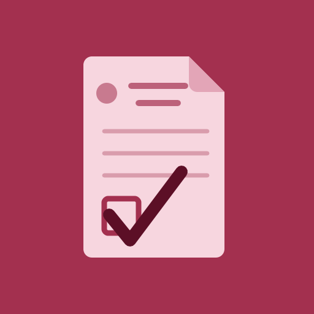

  

<h1 align="center">OT Report</h1>

The KKM surgical report form, HSR (118)O.T/1-20, filled in on your phone or computer
and saved as a PDF that prints on A4 exactly where the paper form expects it.

<b><a href="https://ot-report.github.io/">Open the app</a></b> 
<a href="https://ot-report.github.io/">https://ot-report.github.io/</a>

 

## Install it once

The app runs only when installed. Open the link above on each device, then:

| Device | Steps |
|---|---|
| Android | Chrome: tap **Install app**, or menu ⋮ › **Install app** |
| iPhone, iPad | Safari: **Share** › **Add to Home Screen** |
| Windows, Mac | Chrome or Edge: the install icon in the address bar |

Open it from your home screen or app list. From then on it works in flight mode, and it updates
itself whenever the device is online. Settings shows the version and has **Check for update**.

The first time it opens, it asks for your department, hospital, name and staff lists.
Every new report starts from them.

## Writing a report

1. **Patient and team.** Type the I/C number and the age and gender fill themselves in. A passport
   number works too. Staff names come up as chips to tap.
2. **The case.** Pick one or more case cards from your department and they merge into one report:
   operation title, steps, findings and closure. There are more than 200 cards across 12 departments,
   and you can save your own.
3. **The blanks.** Whatever only you know is left as `___` and flagged under its field, so nothing
   goes out half-filled.
4. **Preview and save.** The preview is the A4 form exactly as it prints. Save the PDF, share it or
   print it.

## Also inside

- A drawing pad over anatomical diagrams (mandible, midface, skull, ankle, wrist, dental charts and
  more), with plates and adjustable screws, fractures, incisions, sutures and shading. A drawing of one
  side, such as the TMJ or the hand, can be switched to the other side. The drawing is printed beside the
  operative findings.
- A teeth builder for OMFS and paediatric dentistry: set what was done to each tooth and it writes the
  procedure for you.
- ICD-10 suggestions as you type a diagnosis. They help you choose the words and are never printed.
- Continuation sheets for text that will not fit on two pages, if your hospital uses them.
- Light and dark mode.

## Patient details stay on the device

The app has no server and no account. Its page is locked so it cannot connect to the internet; the
only thing it ever downloads is a newer copy of itself. What you type is kept in the browser on that
device, and a report leaves it only when you save, print or share the PDF yourself.

On a shared ward computer, set *If the page closes before you save the PDF* to anything but
**Keep everything**.

## Printing

Print at **Actual size** (100%), never *Fit to page*. Every position on the form is measured in
millimetres from the printed original.

## Moving to a new phone

Settings and templates live on each device. In the app, use **Lists & templates › Export**, then
**Import a file** on the new device. Check that your templates hold no patient details before you
send the file.

## Please read

The case cards are starting points, not clinical guidance. Read every line before you sign: the
clinician who signs the report is responsible for it.

This is not an official Ministry of Health (KKM) product and is not endorsed by KKM or any hospital.
Use it where your hospital allows. The signed paper form remains the medical record.

## Found a problem?

Open an issue in this repository. Never include patient names, I/C or M.R. numbers, or a photo of a
filled form.

## Licence

The app is MIT licensed ([LICENSE](LICENSE)). The form font, OT Form Sans, is a subset of Carlito
under the SIL Open Font License 1.1 ([OFL.txt](OFL.txt)). The Jata Negara and the KKM form itself are
not covered by either licence.

 

Made by Aziz Akmal, OMFS surgeon to be.

